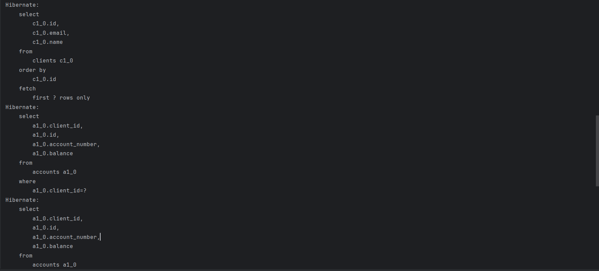

## Запуск проекта

1. Создайте пустую базу данных `minibank` в PostgreSQL.
2. Скопируйте `src/main/resources/application.properties.example` в `src/main/resources/application.properties` и впишите свой пароль от БД.
3. Запустите метод `Main.main()` — таблицы, тестовые данные и индексы создадутся автоматически через Liquibase.

# Модуль 4
## Анализ производительности (EXPLAIN ANALYZE)

### До добавления индекса (Seq Scan)

### После добавления составного индекса (Bitmap Index Scan)

### Дополнительные запросы из презентации (слайд 30)

# Модуль 5
## Основные сценарии HTTP-запросов

### 200 — успех

### 400 — невалидная сумма

### 404 — счёт не найден

### 409 — недостаточно средств

### 200 — успех GET

# Модуль 6

## Работа с JPA / Hibernate и оптимизация проблемы N+1

При переходе на Hibernate была проверена работа ленивой и жадной загрузки связей (`@OneToMany` / `@ManyToOne`) на примере запроса списка клиентов (`GET /clients`).

### Тестовый запрос в Postman

### Проблема N+1 (`FetchType.EAGER`)
При использовании жадной загрузки (`FetchType.EAGER`) для получения списка из `N` клиентов Hibernate выполняет **1 основной запрос** к таблице `clients` и дополнительно **`N` отдельных `SELECT`-запросов** к таблице `accounts` (по одному на каждого клиента):

### Решение (`FetchType.LAZY`)
После перевода связей на ленивую загрузку (`FetchType.LAZY`) Hibernate перестаёт подгружать связанные счета, если они не требуются в ответе API. В результате выполняется **только 1 SQL-запрос** к таблице `clients`:

### Удаление аккаунта (` orphanRemoval = true`)
При удалении аккаунта из коллекции клиента он удаляется у=из базы данных. Пока реализована только логика удаления аккаунта без транзакций и счёт с историей удалить нельзя из-за FK.
